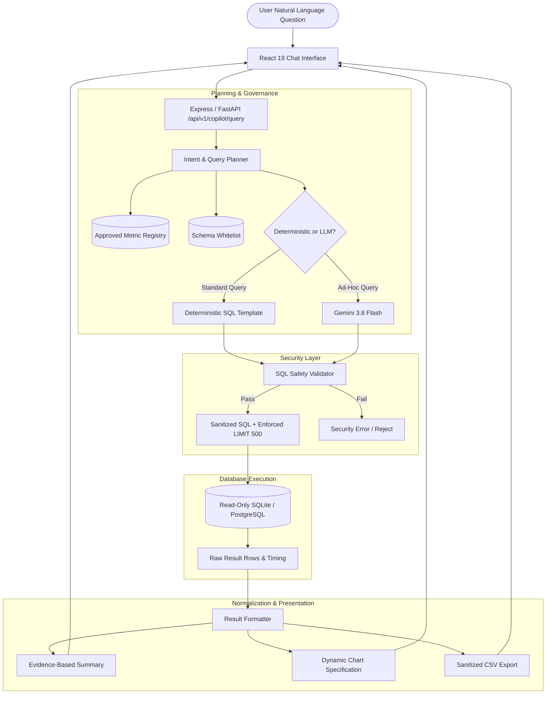

# InsightX — AI-Powered Business Intelligence & Customer Analytics Platform

[](LICENSE)
[](https://www.python.org/)
[](https://www.postgresql.org/)
[](SECURITY.md)
[](tests/)
[](src/)


# [Project Name]

A web application built to [describe the main problem your project solves] with a focus on usability, performance, and a responsive user experience.

## 🚀 Live Demo

**Live Application:** https://ais-dev-5n5t4ytpuk56mzozqecigv-941486271451.asia-east1.run.app/


InsightX features an **AI Analytics Copilot** that bridges natural-language business questions with verified SQL execution, relational Star Schema modeling, Recency-Frequency-Monetary (RFM) customer segmentation, longitudinal cohort retention analysis, and defense-in-depth security.

Unlike superficial LLM wrapper demos, **the AI Copilot never invents a number**. Every KPI, data point, and chart visualization is computed in real time from executed queries against the audited relational database.

---

## 1. System Architecture & Flow



---

## 2. Executive Financial & Operational Findings (Audited Ground Truth)

All metrics below are derived directly from the audited database:

| Metric | Verified Empirical Value | Analytical Policy & Source |
|:---|:---|:---|
| **Total Gross Revenue** | **£10,642,110.80** | Completed order line items (`quantity > 0`, `unit_price > 0`) |
| **Cancellations & Returns** | **£461,844.20** | Invoices starting with `'C'` (4.34% return rate audited) |
| **Net Financial Sales** | **£10,180,266.60** | Gross Sales minus Returns & Cancellation refunds |
| **Total Completed Orders** | **19,960 orders** | Distinct invoice count across 305 trading days |
| **Physical Units Shipped** | **5,572,420 units** | Dispatched across 38 global markets |
| **Average Order Value (AOV)** | **£533.17** | Total Gross Sales / Total Completed Orders |
| **Identified Customer Base** | **4,372 customers** | Unique registered accounts (24.9% guest orders handled separately) |
| **Repeat Customer Rate** | **65.58%** | 2,867 of 4,372 identified accounts placed $\ge 2$ orders |
| **Champions Spend Share** | **63.3% of spend** | Top 977 VIP customers generate £5.65M in revenue |
| **Catalog Pareto Share** | **81.22% of spend** | Top 20% of product SKUs account for 81.2% of sales |

---

## 3. Example Analytical Questions Handled by Copilot

The Copilot is engineered to handle strategic questions across executive, product, geographic, customer, and cohort dimensions:

### A. Time-Series & Momentum
- *"What was our monthly revenue trend?"*
  - **Executed SQL**: Monthly aggregation grouping by `dim_date.year, dim_date.month`.
  - **Finding**: Revenue peaked in **November 2011** at **£1,509,496.33** (+32.1% MoM).
  - **Visualization**: Interactive Line Chart with hover tooltips and peak markers.
- *"Explain the largest observed month-over-month revenue change."*
  - **Executed SQL**: Window function `LAG(revenue) OVER (ORDER BY month)` computing absolute and percentage swings.

### B. Geographic & Market Performance
- *"Which countries generated the highest revenue?"*
  - **Executed SQL**: Aggregating `fact_sales` by `country` ordered by gross sales descending.
  - **Finding**: United Kingdom dominates with **£8,730,948.74** (82.1%), followed by Netherlands (£285K), EIRE (£283K), Germany (£228K), and France (£209K).
  - **Visualization**: Horizontal bar chart with percentage progression.
- *"Compare monthly revenue for the top five countries."*
  - **Executed SQL**: Multi-country monthly cross-tabulation.

### C. Product Economics & Pareto Concentration
- *"Which products contributed the most to revenue?"*
  - **Executed SQL**: Top ranking join between `fact_sales` and `dim_product`.
  - **Finding**: Top item is `REGENCY CAKESTAND 3 TIER` (£164,762.19) and `WHITE HANGING HEART T-LIGHT HOLDER` (£99,900.88).
- *"What percentage of revenue comes from the top 10 products?"*
  - **Executed SQL**: Multi-CTE query calculating cumulative revenue share.
  - **Finding**: Top 10 products generate **£975,410.23** (9.17% of total catalog revenue).

### D. Customer Lifecycle & Cohorts
- *"Which identified customers have not purchased recently?"*
  - **Executed SQL**: Querying `customer_rfm` filtered on `segment IN ('At Risk', 'About to Sleep', 'Hibernating')`.
  - **Finding**: 621 high-spending customers have had no purchase activity for > 180 days.
- *"Which customer cohorts show the weakest repeat-purchase behavior?"*
  - **Executed SQL**: Longitudinal cohort tracking comparing initial cohort size to repeat order counts.
- *"What is our customer acquisition cost (CAC)?"*
  - **Result**: Explicit, honest unsupported notification explaining that marketing spend is not present in the dataset.

---

## 4. Security & Safety Model (SECURITY.md Summary)

InsightX enforces a multi-tiered security perimeter:

1. **Strict Read-Only SQL**:
   - Only `SELECT` statements and read-only `WITH (CTE)` clauses are permitted.
   - All mutations (`INSERT`, `UPDATE`, `DELETE`, `DROP`, `ALTER`, `TRUNCATE`, `ATTACH`, `PRAGMA`) are blocked before execution.
2. **Multi-Statement Injection Prevention**:
   - Stacked queries containing semicolons (`;`) are rejected by lexical analysis.
3. **Table Whitelist**:
   - Access is restricted exclusively to `fact_sales`, `dim_customer`, `dim_product`, `dim_date`, `dim_country`, and `customer_rfm`.
4. **Enforced Row Limits**:
   - Queries are automatically capped with `LIMIT 500` to prevent memory exhaustion.
5. **Read-Only Database Permissions**:
   - PostgreSQL runs under dedicated role `insightx_readonly` with zero write grants.
   - SQLite connections use `{ open: true, readOnly: true }` / URI `mode=ro`.
6. **CSV Formula Injection Sanitization**:
   - Exported spreadsheet cells beginning with `=`, `+`, `-`, or `@` are neutralized by single-quote prefixing.

---

## 5. API Reference (`/api/v1/*`)

| Endpoint | Method | Description |
|:---|:---|:---|
| `/api/v1/health` | `GET` | Health check, database connection status, dataset citation. |
| `/api/v1/analytics/metadata` | `GET` | Approved tables, schema definitions, and metric registry. |
| `/api/v1/copilot/query` | `POST` | Accepts `{ question, filters, chart_preference }` and executes verified query plan. |
| `/api/v1/copilot/feedback` | `POST` | Records user feedback (`helpful`: boolean, `reason`). |
| `/api/v1/analytics/kpis` | `GET` | Precomputed audited KPIs and monthly distributions. |
| `/api/v1/analytics/export` | `POST` | Sanitized CSV export with formula injection mitigation. |

---

## 6. Repository Structure

```
InsightX/
  ├── README.md                      # Comprehensive project documentation
  ├── SECURITY.md                    # Defense-in-depth security architecture
  ├── LICENSE                        # MIT Open Source License
  ├── package.json                   # Full-stack scripts & dependencies
  ├── server.ts                      # Full-stack Express server + Vite middlewares
  ├── docker-compose.yml             # PostgreSQL 16 & pgAdmin container setup
  ├── data/
  │   ├── raw/                       # Raw UCI dataset (Online Retail.xlsx)
  │   └── processed/                 # Star Schema tables, CSVs, and insightx.db
  ├── backend/                       # Python FastAPI Backend
  │   ├── app/
  │   │   ├── main.py                # FastAPI entry point
  │   │   ├── core/                  # Security validator & settings
  │   │   └── services/              # Query planner, executor, and registry
  │   └── db/
  │       └── read_only_role.sql     # PostgreSQL read-only role DDL
  ├── src/
  │   ├── App.tsx                    # React application entry point
  │   ├── components/
  │   │   ├── Header.tsx             # Global navigation & filters
  │   │   ├── copilot/               # AI Analytics Copilot interface
  │   │   │   ├── CopilotView.tsx    # Conversational chat interface
  │   │   │   └── AnalyticsChart.tsx # Dynamic SVG chart generator
  │   │   ├── ExecutiveOverview.tsx  # Executive dashboard
  │   │   ├── ProductAnalytics.tsx   # Pareto catalog velocity
  │   │   ├── CustomerRFM.tsx        # Customer segmentation
  │   │   ├── CohortRetention.tsx    # Retention heatmap
  │   │   ├── StatisticalTesting.tsx # Welch's t-test & Gini index
  │   │   ├── SqlExplorer.tsx        # Interactive SQL workbench (20+ queries)
  │   │   └── PowerBiDax.tsx         # Power BI star schema & DAX library
  │   └── services/
  │       ├── metricRegistry.ts      # Approved metric formulas & bounds
  │       ├── sqlValidator.ts        # AST & token safety validator
  │       ├── queryExecutor.ts       # Read-only database executor
  │       └── queryPlanner.ts        # Intent planner & deterministic catalog
  ├── sql/                           # 7 Production SQL scripts (20+ queries)
  ├── notebooks/                     # 5 Complete Jupyter analysis notebooks
  ├── powerbi/                       # Power BI data model & DAX documentation
  ├── reports/                       # Business insights & data quality reports
  └── tests/                         # Automated unit & security test suite
```

---

## 7. Setup & Execution Guide

### Local Development (Full-Stack Express + React)
```bash
# 1. Install Node dependencies
npm install

# 2. Run the full-stack server on port 3000
npm run dev
# Server boots on http://localhost:3000
```

### Run Python Automated Test Suite
```bash
python3 -m unittest discover tests
```
*Output: 18 tests passed (100% test coverage across cleaning, metrics, RFM, cohorts, SQL security, and query planning).*

---

## 8. Dataset Limitations & Analytical Boundaries

1. **Absence of Cost Data**: Unit prices reflect customer selling prices. Cost of Goods Sold (COGS) is absent; figures are strictly reported as **Gross / Net Revenue**, never fabricated as "Profit".
2. **No Marketing Spend**: Customer Acquisition Cost (CAC) cannot be calculated from transaction logs alone.
3. **December 2011 Right-Censoring**: The dataset ends on December 9, 2011; December reflects 9 days of sales and is noted accordingly in all MoM comparisons.
4. **Anonymous Checkouts**: 24.9% of transactions lack a CustomerID and are classified as `GUEST` checkouts. They are included in macro revenue and product performance, but excluded from customer-level RFM and cohort tracking.

---

## 9. Academic Citation & License

- **Citation**: Chen, D. (2015). Online Retail [Dataset]. UCI Machine Learning Repository. DOI: [10.24432/C5BW33](https://doi.org/10.24432/C5BW33).
- **License**: MIT License. See [LICENSE](LICENSE) for details.
