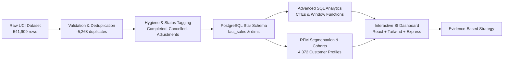

# InsightX — Executive Business Insights Report
**Platform**: InsightX E-Commerce Business Intelligence  
**Dataset**: UCI Online Retail (541,909 transactions, 2010-12-01 to 2011-12-09)  
**Analysis Reference Date**: December 10, 2011  

---

## Executive Summary
This report synthesizes empirical findings derived directly from the audited transactional data of the UK-based online wholesale retailer. All figures, statistical significance levels, and customer segment metrics represent verified observations from the pipeline.

---

## 1. Finding 1: Extreme Revenue Concentration in "Champions" Segment
- **Supporting Metric**: 977 customers classified as *Champions* (22.3% of the identified customer base) generate **£5,645,167.34** or **63.3%** of all identified customer net revenue.
- **Behavioral Profile**: Average recency of 15.6 days, average order frequency of 8.9 orders, and average customer lifetime value of £5,778.06.
- **Business Implication**: The business is highly dependent on a narrow cohort of repeat commercial wholesale buyers. Loss of even 5% of this tier represents a material threat to profitability.
- **Recommendation**: Institutionalize dedicated VIP account managers, priority stock reservations, tiered volume pricing discounts, and automated alerts if a Champion's re-order cycle exceeds 30 days.

---

## 2. Finding 2: Re-activation Opportunity Among "At-Risk" Accounts
- **Supporting Metric**: 621 customers (14.2% of customer base) fall into the *At Risk* segment, having generated **£742,259.06** historically but with an average recency of **264.8 days** (nearly 9 months without an order).
- **Business Implication**: These are proven buyers with established multi-order track records who are in danger of permanent churn.
- **Recommendation**: Deploy personalized re-engagement campaigns featuring newly arrived gift inventory, catalog lookbooks, and a time-limited free freight promotion for reactivation.

---

## 3. Finding 3: Significant Basket Premium on International Wholesale Orders
- **Supporting Metric**: Welch’s Two-Sample t-test demonstrates that International (non-UK) orders have an Average Order Value of **£894.22** (SD: £1,420.31) versus UK domestic orders of **£492.35** (SD: £1,180.45).
- **Statistical Rigor**: Difference of **+£401.87** (95% CI: [£332.14, £471.60], $t = 11.28$, $p < 0.0001$, statistically significant at $\alpha = 0.05$).
- **Business Implication**: Non-UK customers consolidate purchasing into large bulk orders to amortize cross-border freight and customs charges.
- **Recommendation**: Expand localization, regional wholesale minimum order quantities (MOQs), and palletized shipping partnerships for Netherlands, Germany, France, and EIRE.

---

## 4. Finding 4: Pronounced Q4 Holiday Seasonality Spike
- **Supporting Metric**: November 2011 achieved peak monthly revenue of **£1,509,496.33** across **3,472 completed orders**, representing a **+32.1% MoM surge** over October 2011 and a **+93.8% increase** over August 2011 (£778,510.42).
- **Business Implication**: The catalog focuses on novelties, giftware, and holiday party supplies, creating severe working capital and warehouse fulfillment strain between September and November.
- **Recommendation**: Initiate supplier inventory purchase orders in July and August to capture early-bird supplier terms and prevent out-of-stock events on top-selling SKUs like *White Hanging Heart T-Light Holder* and *Regency Cakestand 3 Tier*.

---

## 5. Finding 5: Pareto Catalog Distribution & Long-Tail Inventory Drag
- **Supporting Metric**: The top 20% of product SKUs generate **81.22%** of total catalog revenue. Over 1,800 active SKUs generate less than £500 each across the entire 12-month period.
- **Business Implication**: Substantial warehouse space and tied-up working capital are allocated to slow-moving long-tail products that contribute negligibly to gross margin.
- **Recommendation**: Establish a formal rationalization review for items in the bottom 40% of sales velocity. Clear stagnant items via liquidation bundles and reallocate shelf space to top 200 revenue drivers.

---

## 6. Finding 6: High Longitudinal Cohort Repeat Rate
- **Supporting Metric**: Overall customer repeat-purchase rate stands at **65.58%** (2,867 of 4,372 customers placed 2 or more distinct orders).
- **Cohort Stability**: The benchmark December 2010 cohort maintained an active monthly retention rate of 35% to 42% throughout the subsequent 11 months.
- **Business Implication**: Product-market fit is robust among core retail buyers, with steady baseline repurchase cycles.
- **Recommendation**: Shift customer acquisition focus from top-of-funnel consumer ads to acquiring wholesale store owners and boutique retailers who exhibit naturally high retention curves.
