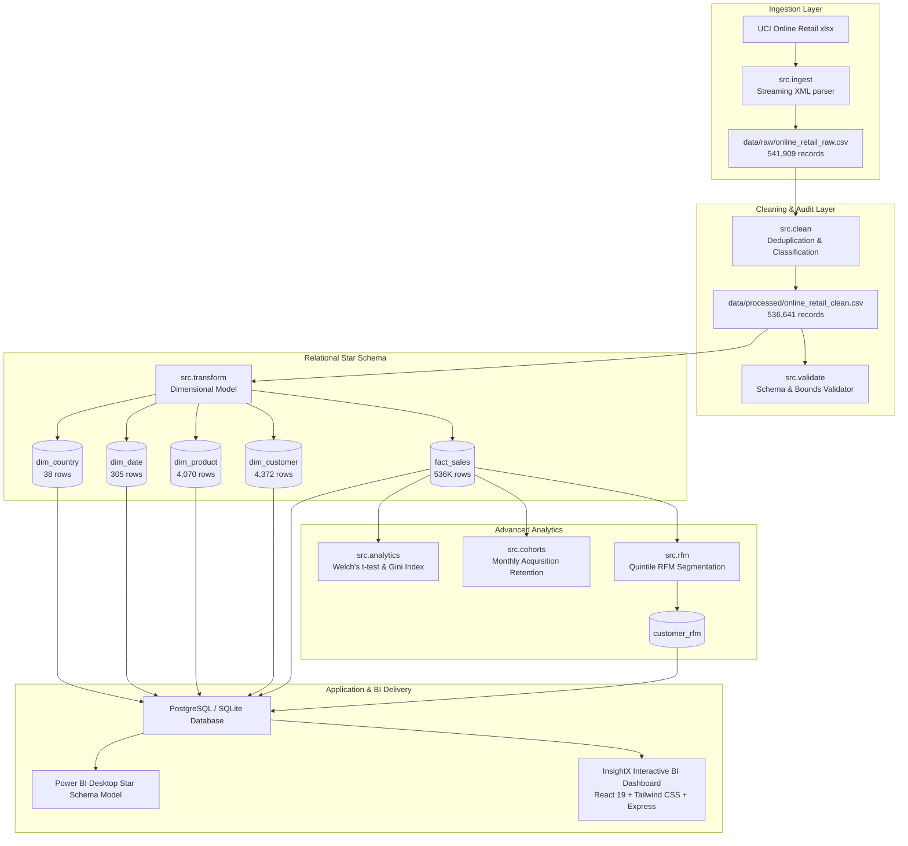

# InsightX — Methodology & Technical Architecture

## 1. Data Pipeline Architecture

## 2. RFM Segmentation Scoring Rules
RFM calculates three core parameters for each identified customer evaluated against snapshot reference date **December 10, 2011**:
- **Recency ($R$)**: Days between 2011-12-10 and customer's latest completed transaction. Ranked into quintiles 1 to 5 (score 5 = lowest recency days, highly engaged).
- **Frequency ($F$)**: Count of unique completed orders (`COUNT(DISTINCT invoice_no)`). Ranked into quintiles 1 to 5 (score 5 = most frequent).
- **Monetary ($M$)**: Net customer spend (`Gross Revenue - Cancellation Refunds`). Ranked into quintiles 1 to 5 (score 5 = highest spend).

### Segment Definitions:
- **Champions**: $R \in [4, 5], F \in [4, 5], M \in [4, 5]$
- **Loyal Customers**: $R \in [3, 5], F \in [3, 5]$
- **Potential Loyalists**: $R \in [4, 5], F \in [1, 2]$
- **Promising**: $R \in [3, 4], F \in [1, 2], M \in [1, 2]$
- **Need Attention**: $R = 3, F = 3$
- **About to Sleep**: $R = 2, F \in [1, 2]$
- **At Risk**: $R \in [1, 2], F \in [3, 5]$
- **Cannot Lose Them**: $R = 1, F \in [4, 5]$
- **Hibernating**: $R \in [1, 2], F \in [1, 2]$

## 3. Cohort Retention Methodology
- **Acquisition Month**: Customer's earliest qualifying transaction month ($M_0$).
- **Active Month**: Any calendar month ($M_k$) wherein the customer placed at least 1 completed purchase.
- **Period Offset**: $k = (Year_k - Year_0) \times 12 + (Month_k - Month_0)$.
- **Retention Rate**: $\text{Retention Rate} = \frac{\text{Active Customers in Period } k}{\text{Initial Cohort Size at Period 0}} \times 100\%$.
- **Right-Censoring**: Cohorts acquired in later months (e.g. November 2011) only have 1 subsequent month of observation, marked as right-censored beyond their observation window.

## 4. Statistical Rigor & Hypothesis Testing
- **Welch's Two-Sample t-test**: Used to compare Mean Order Value between UK and International orders without assuming equal variance ($\sigma_1^2 \neq \sigma_2^2$).
  $$t = \frac{\bar{X}_1 - \bar{X}_2}{\sqrt{\frac{s_1^2}{n_1} + \frac{s_2^2}{n_2}}}$$
  Degrees of freedom computed using the Welch-Satterthwaite equation.
- **Gini Coefficient ($G$)**: Measures concentration of spend among identified buyers:
  $$G = \frac{\sum_{i=1}^n (2i - n - 1) x_i}{n \sum_{i=1}^n x_i}$$
  where $x_i$ is ordered customer spend ($x_1 \le x_2 \le \dots \le x_n$).
